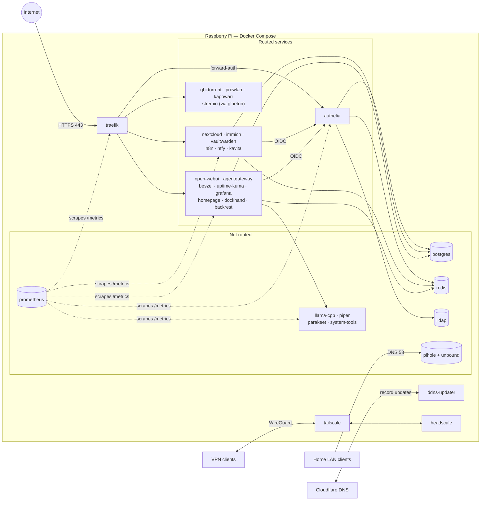
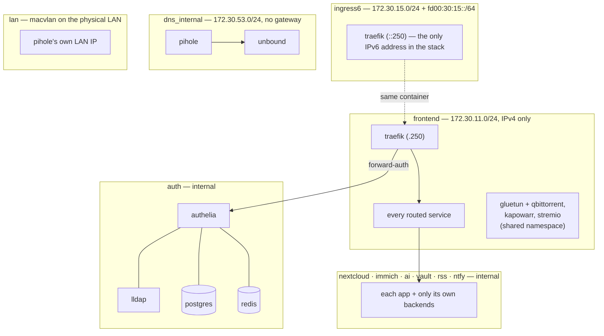

# Architecture

One Raspberry Pi, one Docker Compose file, one systemd unit. Traefik is the only way in from the internet; everything else is reachable only from the LAN, the tailnet, or another container.

## The shape of it



Every routed service follows the same path: TLS at Traefik, then the `lan` IP allowlist, then either forward-auth to Authelia or the service's own OIDC login. The rules per service are in [Security](SECURITY.md#per-service-protection).

## What each service is for

| Service | Purpose | Reached by |
|---------|---------|------------|
| **Traefik** | Reverse proxy, TLS termination, middleware chains | the internet, on 443 |
| **ddns-updater** | Keeps the Cloudflare records pointed at your public IP | Cloudflare API |
| **Authelia** | SSO portal, OIDC provider, forward-auth backend | all users |
| **LLDAP** | The user and group directory — one source of truth | Authelia, Nextcloud, Dockhand |
| **PostgreSQL** | Database for Nextcloud, Immich, Authelia, LLDAP, Vaultwarden, Open WebUI, FreshRSS, Forgejo | app containers |
| **Redis (Valkey)** | Session store and cache, password-protected — see [Security](SECURITY.md#the-shared-redis-is-authenticated) | Authelia, Immich, Nextcloud, AIOMetadata |
| **Pi-hole** | Ad blocking, local DNS for `*.<HOST_NAME>` | LAN and VPN clients |
| **Unbound** | Recursive resolver — walks the delegation tree itself | Pi-hole only |
| **Headscale** | Self-hosted Tailscale control plane | VPN clients, from anywhere |
| **Headplane** | Web UI for Headscale | admins, LAN-only + 2FA |
| **Tailscale** | The Pi's own VPN node; advertises the LAN and an exit node | your devices |
| **Nextcloud** | Files, sharing, collaboration | users |
| **Immich** | Photo and video library with ML tagging | users |
| **immich-machine-learning** | Immich's ML worker: face and object tagging, CLIP search | Immich only |
| **Vaultwarden** | Bitwarden-compatible password manager | Bitwarden clients |
| **n8n** | Workflow automation | users |
| **n8n-runners** | Isolated task runner that executes n8n Code nodes | n8n only |
| **ntfy** | Push notifications | the other services |
| **Kavita** | Comics, manga and ebook reader | users, and OPDS clients |
| **Gluetun** | VPN gateway; owns the network namespace for qBittorrent, Kapowarr and Stremio | those three |
| **qBittorrent** | Torrent client, all traffic through Gluetun | users |
| **Prowlarr** | Indexer manager | users |
| **FlareSolverr** | Solves the Cloudflare challenges of Prowlarr's protected indexers and Kapowarr's download source | Prowlarr and Kapowarr only, on a segment of their own |
| **Kapowarr** | Comics and manga manager; feeds the Kavita libraries | users |
| **Shelfmark** | Book and audiobook search; files what it downloads into the Kavita Books library | users |
| **Audiobookshelf** | Audiobook player for `download/audiobooks/`, with Audible metadata matching and progress sync | users |
| **FreshRSS** | RSS/Atom reader; per-account subscriptions and read state in Postgres, refreshed by its own cron | users, and Google Reader API clients |
| **SearXNG** | Metasearch: forwards a query to many upstream search engines and merges the answers; keeps no index and no accounts | users (browser and Homepage), and Open WebUI's web search |
| **Trilium** | Personal knowledge base: a single-owner note tree in SQLite, edited in the browser | the owner, plus the Web Clipper and ETAPI scripts |
| **Forgejo** | Git forge: repositories, issues, pull requests and releases. Repositories and LFS objects on disk, everything else in Postgres. Clones and pushes over **HTTPS only** — git-over-SSH is off, because it would need a published host port and `:22` is the Pi's own sshd | users, in a browser and over `git`/`/api/v1` with a personal access token |
| **Tuwunel** | Matrix homeserver for the family chat, on an embedded RocksDB — no Postgres, no Redis. Federation off: nobody outside this server can join a room or send to one. Accounts come from LLDAP through Authelia on the first sign-in, and the first one becomes the server admin. Also the OAuth server Element X signs in through (next-gen auth), which it brokers to Authelia | Element Web and Element X, over `chat.<HOST_NAME>/_matrix` |
| **Element Web** | Browser client for Tuwunel, served from `chat.<HOST_NAME>`. Static files and a `config.json` rendered by `scripts/element-pre-start.sh`: integration managers, identity server, guests and account deactivation off | users, in a browser |
| **changedetection.io** | Watches web pages and notifies on what changed; keeps its own compressed snapshot history and publishes an RSS feed of the diffs | users, and the ntfy `watches` topic |
| **Stremio** | Streaming server | users |
| **AIOStreams** | Stremio super-addon: fans a title out to upstream addons and the debrid service, then filters and ranks the results (its "SEL" expressions). Streams only — it serves no catalogue. `scripts/aiostreams-pre-start.sh` points its built-in Prowlarr scraper at the stack's own Prowlarr, so whatever indexers you add there reach Stremio's result lists, including ones no public addon covers | users, through Stremio |
| **AIOMetadata** | The other half: catalogs and metadata for Stremio (TMDB/TVDB/MAL/MDBList), with its own artwork proxy and disk cache. Installed alongside AIOStreams, not inside it | users, through Stremio |
| **StremThru** | Two features only. **SideKick** edits the Stremio addon collection — reorder, enable or disable part of an addon — which Stremio's own UI cannot do, and which is what puts AIOMetadata in front of Cinemeta. **Torz** is a stream source for AIOStreams, contributing the DebridMediaManager hashlists and the torrent database shared between StremThru instances — neither of which AIOStreams' other scrapers nor the stack's Prowlarr indexes. Every other feature is off: `STREMTHRU_FEATURE` is an allowlist | the owner in a browser, and AIOStreams server-side |
| **stremio-lan** | The same Stremio server on a LAN macvlan address instead of the VPN, for DLNA casting — mutually exclusive with `stremio` | users, LAN renderers |
| **Open WebUI** | Local AI chat frontend — see [Local AI](AI.md) | users |
| **Agentgateway** | LLM and MCP gateway in front of llama.cpp: one OpenAI-compatible endpoint, one MCP endpoint, virtual keys and token rate limits | Open WebUI, and any API or MCP client |
| **OpenClaw** | The family assistant, `@assistant` in the Matrix chat: one agent per LLDAP account plus a shared agent in a family room, thinking through agentgateway's `/assistant/v1` route. No tool that executes, browses or fetches, and no network that leads out; it searches through SearXNG and works in each person's own Nextcloud — see [Local AI](AI.md#the-family-assistant-openclaw) | family members, in an encrypted DM or the family room |
| **llama.cpp / Piper / Parakeet / system-tools** | Inference, TTS, STT and the host-status tool | Agentgateway, Open WebUI |
| **Homepage** | Dashboard with live widgets | users |
| **Beszel** | Hardware metrics and threshold alerts | admins |
| **beszel-agent** | Host-side collector, opens a WebSocket *to* the Beszel hub through Traefik | Beszel only |
| **Uptime Kuma** | Service and route monitoring | admins |
| **Prometheus** | Scrapes the /metrics endpoints the stack already serves and keeps 90 days of them. No UI and no Traefik router — Grafana is the only reader | Grafana |
| **Grafana** | The dashboards over Prometheus: LLM spend and tokens, Traefik request rates, Authelia outcomes, service queues | admins, 2FA |
| **Dockhand** | Container management UI | admins, 2FA |
| **Backrest** | Nightly restic backups | S3 |

## Network isolation

Containers only share a network when they have to talk:



The effect: a compromised app container cannot query Unbound directly, cannot reach LLDAP, and cannot see another app's database traffic. `frontend` stays IPv4-only for a related reason: an IPv6 subnet there would give gluetun a global-egress address, and the three containers sharing its namespace would leave the tunnel — so Traefik carries the stack's only IPv6 address, on a network of its own. The full table of networks, subnets and members is in [Networking](NETWORKING.md#network-isolation).

## Where the data is

```
pi-pcloud/
├── .env                # your configuration and secrets
├── compose.yaml        # include:, plus every network and volume
├── compose/            # the services, one file per domain
├── Makefile            # the commands
├── scripts/            # pre-start, bootstrap and OIDC-wiring hooks
├── config/             # per-service configuration templates
└── docs/
```

`compose.yaml` declares no service of its own: it `include:`s the eight domain files under `compose/` — `compose-core.yaml`, `compose-identity.yaml`, `compose-network.yaml`, `compose-cloud.yaml`, `compose-media.yaml`, `compose-knowledge.yaml`, `compose-ai.yaml`, `compose-monitoring.yaml`. Every command runs against the project root; a file under `compose/` is not startable on its own. Networks, volumes and the `x-cpu-prio-*` / `x-oom-score-*` / `x-healthcheck-*` tiers are defined in the root file. YAML anchors do not cross files, so each domain file repeats the tiers it uses.

Traefik is the exception to `config/` — it has no config directory, being driven entirely by CLI flags and Docker labels in `compose/compose-core.yaml`.

Persistent state is split deliberately:

| Where | What | Why |
|-------|------|-----|
| `${DATA_LOCATION}` (default `./data`) | `nextcloud`, `immich`, `authelia-config`, `lldap`, `vaultwarden`, `uptime-kuma`, `backrest`, `download`, `comics`, `manga`, `n8n`, `open-webui`, `agentgateway`, … | Anything you would miss, sized for media. Backrest mounts most of it read-only |
| `${POSTGRES_DATA_LOCATION}` (defaults to `${DATA_LOCATION}`) | `postgres18` — the cluster shared by Immich, Nextcloud, Authelia, lldap, Open WebUI, Vaultwarden, FreshRSS and Forgejo | **Point this at solid-state storage.** ~1 GB, and the only thing here that suffers from sharing a spindle with media I/O. See below |
| Named Docker volumes | Pi-hole, Redis, Headscale, Beszel, ntfy, Kavita config, Tuwunel (database, media, backups), OpenClaw state, llama.cpp weights, Prometheus TSDB, Grafana, … | Smaller state, and the write-heavy or regenerable state that belongs on the fast root filesystem rather than in backups |

`DATA_LOCATION` is usually the largest disk available, which on a Pi is usually an external USB one. That is the right home for originals and downloads and the wrong home for a database: a rotational disk serves random reads at tens of IOPS, and consumer USB-SATA bridges commonly acknowledge a flush before the data reaches the platter, which is a corrupt cluster after a power cut rather than a slow one. `POSTGRES_DATA_LOCATION` exists so the cluster can sit on the root NVMe while the media stays on the big disk. Postgres writes a few hundred MB a day there, so the flash wear it adds is immaterial.

The `ghcr.io/immich-app/postgres` image also ships two tuning profiles selected by `DB_STORAGE_TYPE`, and it **defaults to `SSD`** — which sets `effective_io_concurrency=200` and `random_page_cost=1.2`. If you leave the cluster on a rotational `DATA_LOCATION`, set `DB_STORAGE_TYPE: HDD` on the postgres service in `compose/compose-core.yaml`; the defaults model a random read as ~90x cheaper than that disk can deliver.

### The reading libraries

Two readers, split by medium: Kavita for anything paged, Audiobookshelf for anything
listened to. Kavita has no audiobook library type at all, and Audiobookshelf reads only
audio — so neither is a subset of the other and both point at their own folders.

Kavita gets one library per kind of content, because the library *type* decides how it
parses filenames and how it reads: right-to-left for manga, a comic parser for issues,
a text reader for epub/pdf. Each library therefore needs its own folder.

| Kavita library | Type | Reads | Filled by |
|----------------|------|-------|-----------|
| Comics | ComicVine | `comics/` + `download/comics/` | Kapowarr (root folder) and the `comics` qBittorrent category |
| Manga | Manga | `manga/` + `download/manga/` | Kapowarr (second root folder) and the `manga` qBittorrent category |
| Books | Book | `download/books/` | the `books` qBittorrent category, and Shelfmark's imports |
| Magazines | Comic | `download/magazines/` | the `magazines` qBittorrent category |

Comics and Manga each pair a Kapowarr root folder with a `download/` one because
Kapowarr *owns* its roots: it moves files inside them with copy-then-delete, which
races a torrent seeding from the same tree. A hand-grabbed issue therefore goes to
`download/comics/`, which Kapowarr never touches, and Kavita reads both folders as one
library — so the parser, the metadata provider and the OIDC library grant are shared.

Magazines is a Comic library because Kavita has no magazine type, and the comic parser
groups issues by the `<title> <number>` in their filename. An issue must therefore be
named `<Series> <NNN>.pdf` to join its series; the folder name is not used, and a title
embedded in the PDF overrides the filename. Details in `scripts/kavita-library-bootstrap.sh`.

Everything else under `download/` stays invisible to Kavita, which matters because
Kavita indexes *every* subfolder of a folder it is given — point it at the download
root and a software torrent's installer tree becomes a list of series.

| Path | Written by | Read by Kavita |
|------|-----------|----------------|
| `download/manga/`, `download/comics/`, `download/books/`, `download/magazines/` | the matching qBittorrent category | yes |
| `download/audiobooks/` | the `audiobooks` qBittorrent category, and Shelfmark (`DESTINATION_AUDIOBOOK`); read by **Audiobookshelf**, not Kavita | no |
| `download/shelfmark/` | qBittorrent's `shelfmark` and `shelfmark-audiobooks` categories, where Shelfmark's own grabs land before import | no |
| `download/prowlarr/` | qBittorrent's `prowlarr` category (Prowlarr's default) | no |
| `download/incomplete/` | qBittorrent's temp path | no |
| `download/` (root) | torrents added by hand with no category — nothing indexes it | no |

### qBittorrent categories

The category is the whole routing decision: its save path is the destination, so it is
also what to pick when adding a torrent by hand. `LIBRARY_CATEGORIES` in
`scripts/qbittorrent-bootstrap.sh` owns the list, `QB_CATEGORY_MAP` in
`scripts/prowlarr-bootstrap.sh` the category ids Prowlarr maps onto it. The mapped rows
are in the map's order, which matters (below).

| Category | Save path | Destination | Prowlarr ids |
|----------|-----------|-------------|--------------|
| `comics` | `download/comics/` | Kavita, **Comics** | tracker-specific ids only |
| `manga` | `download/manga/` | Kavita, **Manga** | 7030 + tracker-specific ids |
| `audiobooks` | `download/audiobooks/` | **Audiobookshelf** | 3030 + tracker-specific ids |
| `magazines` | `download/magazines/` | Kavita, **Magazines** | 7010 + tracker-specific ids |
| `books` | `download/books/` | Kavita, **Books** | 7000, 7020, 7040, 7050, 7060 |
| `shelfmark` | `download/shelfmark/` | staging — Shelfmark imports it | — |
| `shelfmark-audiobooks` | `download/shelfmark/` | staging, same folder; a label so the list distinguishes the two | — |
| `prowlarr` | `download/prowlarr/` | nothing; Prowlarr's fallback for unmapped ids | — |

Prowlarr picks the client category from the release's category ids, and a release that
matches no mapping falls through to `prowlarr`. **newznab has no manga category**: manga
and comics both ship as 7030 `Books/Comics`, so 7030 goes to `manga` and an ambiguous
comic lands there too. 7010 `Books/Mags` gets its own destination and the remaining Books
subcategories go to `books`. Audiobooks are 3030 `Audio/Audiobook`, a sibling of the
music ids rather than a Books subcategory, so 3010 MP3 and 3040 Lossless still fall
through. Some indexers also send their own tracker category ids next to the newznab
ones; where those tell comics, manga or audiobooks apart better than the newznab id
does, they are mapped too — see `QB_CATEGORY_MAP`.

`books` also claims **7000**, the bare Books parent, which says nothing about *which*
kind of book. It has to: some indexers declare no Books subcategory at all, and without
it their book grabs would land in the `prowlarr` folder nothing indexes. Wrong library
beats invisible.

**The order of the mappings is load-bearing, and `books` must stay last.** Prowlarr
takes the first mapping in list order whose ids intersect the release's, not the most
specific one. A release can carry the 7000 parent beside its specific id, so anything
listed below `books` would never be reached.

Two more rules:

- **`comics` has no newznab id.** It shares 7030 with manga, so only an indexer's own
  comic id routes there; otherwise the category is hand-pick only — which is its
  purpose, as the fallback for issues Kapowarr cannot find. `magazines` is in a similar
  position: only releases an indexer tags as 7010 reach it automatically.
- **The staging categories are not destinations.** Shelfmark post-processes only
  torrents belonging to one of its own tasks, so a torrent added there by hand
  downloads and then sits forever. Shelfmark routes by the task's content type, not by
  category, which is why the two staging categories can share one folder.

A grab that lands in the wrong category is recoverable rather than lost: qBittorrent has
`category_changed_tmm_enabled` on, so changing a torrent's category relocates its files
to the new save path — provided the torrent is in Automatic Torrent Management mode,
which Prowlarr's grabs are and Shelfmark's are not (it passes an explicit save path,
which forces Manual).

These paths are set in several places that must agree, all provisioned by the stack: the
`kavita` volumes in `compose/compose-media.yaml`, `DESIRED_LIBRARIES` in
`scripts/kavita-library-bootstrap.sh`, `LIBRARY_CATEGORIES` in
`scripts/qbittorrent-bootstrap.sh`, `QB_CATEGORY_MAP` in
`scripts/prowlarr-bootstrap.sh`, `ROOT_FOLDERS` in `scripts/kapowarr-bootstrap.py`,
`INGEST_DIR` and `DESTINATION_AUDIOBOOK` on the `shelfmark` service, and
`LIBRARY_PATH` in `scripts/audiobookshelf-bootstrap.sh`.

### Shelfmark

Shelfmark is the manual half of that: you search, it fetches. Torrents go out through
the same qBittorrent instance (so through the VPN) under its own `shelfmark` category,
and Shelfmark then renames the finished file into `download/books/`, where Kavita
already looks. Its grabs are saved outside that folder so Kavita indexes the imported
book and not the torrent's directory tree.

Shelfmark sits on `frontend`, not in gluetun's namespace, so it does not join the set of
routers that disappear when gluetun goes unhealthy. Its direct downloads still egress
through the tunnel, via gluetun's internal HTTP proxy (`HTTPPROXY=on`, port `8888`). The
proxy is set in Shelfmark's `plugins/network.json` rather than as `HTTP_PROXY` in its
environment, which the HTTP library would apply to every outbound call: this way only
the release-source and download path uses the tunnel, while the Prowlarr API, the OIDC
token exchange and the metadata providers stay direct — and a gluetun outage costs you
direct downloads, not search or login. The proxy is addressed as `gluetun.docker`, an
alias `compose/compose-media.yaml` adds because Shelfmark's bundled bypasser rejects a
proxy host with no dot in it.

The dependency is soft: Shelfmark is **not** in gluetun's profile list, so enabling it
does not force a VPN container on an install that only wants Prowlarr-backed search.
`scripts/shelfmark-settings-bootstrap.sh` configures the proxy only when gluetun is part
of the current selection (`docker compose config --services`, not whether it is
running); otherwise it unwinds its own proxy setting and says so in the start log. A
proxy set by hand is left alone.

### Audiobookshelf

Audiobookshelf mounts `download/audiobooks/` read-only as `/audiobooks` — the folder
Shelfmark files audiobooks into — and adds the listening half: progress sync across
devices, and Audible metadata matching, the only source in the stack carrying narrator,
runtime and chapters. The Audible storefront is regional, so
`scripts/audiobookshelf-bootstrap.sh` picks the provider from `DEFAULT_LANGUAGE`.

None of its configuration can come from the environment or a config file — server
settings live only in its SQLite database — so that bootstrap drives the admin API
instead, and creates the root account first to have anything to authenticate with.
Three consequences:

- **The root account *is* the SSO account.** The bootstrap gives it `EMAIL` and sets
  `authOpenIDMatchExistingBy: email`, so signing in through Authelia lands on the admin
  rather than on a second, plain-user account.
- **Local login is off** (`authActiveAuthMethods: ["openid"]`), so the shared `PASSWORD`
  is not a second door into a service that holds everyone's listening history — the
  same stance as Shelfmark, Dockhand and Beszel. It is gated on the bootstrap first
  minting itself an API key, stored at
  `${DATA_LOCATION}/audiobookshelf/config/pi-web-api-key`, because with `local` disabled
  `/login` stops answering altogether (500, not 401) and the API is the only way back
  in. `audiobookshelf-bootstrap.sh`, `homepage-widgets-bootstrap.sh` and
  `rotate-password.sh` all use that key, and it sits inside the `/config` directory
  Backrest snapshots. Every client can do OIDC, which is why this is safe here and
  would not be for Kavita's OPDS readers: the mobile apps get their own redirect URI
  (`/auth/openid/mobile-redirect`), which Audiobookshelf bounces to
  `audiobookshelf://oauth` itself.
- **The client asks for no `groups` scope.** Audiobookshelf reads the group claim as a
  *role* and denies any login whose groups contain none of `admin`/`user`/`guest`.

Podcasts are deliberately not offered. Audiobookshelf downloads episodes *into* the
library folder, and its own mount of that folder is `:ro`, so a podcast library would
fail with `EROFS` on its first fetch. It would need a writable mount of its own, which
nothing in the download chain feeds.

### Kapowarr folder naming

Kapowarr's `volume_folder_naming` is deliberately flat (`{series_name} ({year})`, no
volume subfolder): Kavita's ComicVine parser takes the series name from the deepest
folder below the scan root, so any intermediate folder makes every series come out
named `Volume 01`.

### The libraries in Nextcloud

The libraries are also mounted into Nextcloud as `files_external` mounts (`Comics`,
`Manga`, `Books` and `Audiobooks`, alongside `Downloads`), so any file can get a public
share link the way Immich does for photos — and so Nextcloud is where the tree gets
**organised**: renamed, moved between libraries, deleted. Audiobooks are in both places
on purpose: Nextcloud shares the file, Audiobookshelf plays it and keeps your position.
The mounts are created by `config/nextcloud/hooks/post-installation/20-external-storage.sh`,
a *post-installation* hook, so it does not fire again on an existing Nextcloud when a
mount is added to its list. It is idempotent and can be re-run by hand:

```bash
docker exec -u www-data pi-nextcloud sh /docker-entrypoint-hooks.d/post-installation/20-external-storage.sh
```

The bind mounts are read-write, but Nextcloud's PHP runs as uid 33 while the tree
belongs to uid/gid 1000 in mode 0755, so `scripts/nextcloud-pre-start.sh` grants uid 33
write access with a POSIX ACL, including a *default* ACL that new files and directories
inherit. Two tempting alternatives do not work:

- **`group_add: "1000"`.** Apache calls `initgroups()` when it drops to `www-data`, which
  discards the supplementary gid compose added. The group *does* show up in a
  `docker exec`, so it passes a hand test and then fails every real request.
- **`chmod -R g+w`.** qBittorrent, Kapowarr and Shelfmark all run with umask 022, so
  every directory they create afterwards comes back `0755` and Nextcloud loses access to
  exactly the new downloads. A default ACL is inherited whatever the umask.

The trade-off is deliberate: `Downloads` is writable too, and qBittorrent seeds from
there, so deleting a file in Nextcloud can break the torrent still serving it. Kapowarr's
moves are copy-then-delete, so avoid reorganising `Comics`/`Manga` while it has a task
running.

### Feeds

FreshRSS has no file library at all. Subscriptions, articles and per-account read state
live in the shared PostgreSQL (database and role `freshrss`), reached over its own
`internal: true` `rss` segment; `${DATA_LOCATION}/freshrss` holds only `data/config.php`,
the per-user `config.php` files, and caches. It is on `frontend` as well, and not just
for Traefik — fetching arbitrary feeds *is* the job, so an internal-only placement would
break it.

Refreshing is the image's own cron, enabled by `CRON_MIN` (twice an hour here). Left
unset, the image installs no crontab at all and feeds only update when a browser asks.

The SSO wiring is why the **Debian** image is pinned rather than `-alpine`: the OIDC flow
runs in Apache through `mod_auth_openidc`, which only that variant ships. Apache passes
the `preferred_username` claim down as `REMOTE_USER`; FreshRSS is installed with
`--auth-type http_auth`, trusts it, and auto-registers an account on first sign-in, so
every LLDAP account gets its own reading list. `/api/greader.php` stays outside that gate
for feed-reader apps and checks the account's own API password, which is `PASSWORD`. The
access rules are in [Security](SECURITY.md#per-service-protection).

That password lands in two places a rotation has to reach together — the `freshrss`
Postgres role and `data/config.php`, written once at install — so `rotate-password.sh`
rewrites the file first (`cli/reconfigure.php`) and runs `ALTER ROLE` second, the same
order it uses for Nextcloud's `dbpassword`.

### Pages that publish no feed

changedetection.io covers the other half of the same need: a price, a stock status, a
page that changes without ever announcing it. It has no database — the watch list, the
settings and the brotli-compressed snapshot history are plain files under
`${DATA_LOCATION}/changedetection`, so Backrest's read-only mount of that directory is
the whole backup and there is no `db-backup.sh` hook for it.

It sits on `frontend`, like FreshRSS and SearXNG, because fetching arbitrary hosts *is*
the job. `ALLOW_IANA_RESTRICTED_ADDRESSES=false` refuses a watch URL whose hostname
resolves to a private, loopback or link-local address, so a watch cannot be aimed at a
neighbouring container or the router's admin page; it is upstream's default, pinned
explicitly. The narrow exception that lets it reach ntfy is described in
[Security](SECURITY.md#changedetectionio-fetches-whatever-it-is-told-to).

Notifications go to the ntfy `watches` topic. The Apprise URL is seeded as the *system
default* by `scripts/changedetection-bootstrap.sh` — the list is a datastore setting
with no environment equivalent, so it can only be written through the API, with the
token the datastore mints on its first start. A per-watch URL still overrides it, and
the hook only ever appends, so a list edited by hand keeps its entries.

**One real limit:** only the plain-HTTP fetcher is available. The image carries the
Playwright *client*, but the browser itself is a second container (`sockpuppetbrowser`,
Chrome) that is not deployed here, to save the RAM a headless Chrome per check would
take. Pages that render their content in JavaScript therefore cannot be watched, and the
browser-step and visual-selector features are inert.

## Rationing CPU and memory

On the 16 GB reference host, four cores and the RAM are shared by ~40 containers
including a local LLM. The sum of the `mem_limit`s is close to twice the RAM, which is
deliberate — they are ceilings on a service that misbehaves, not an allocation. What
matters is who gives way first when the machine is actually short, and that is
expressed in three separate knobs, none of which substitutes for another. The picker
behind `make config` adds the ceilings up for the selection being made, graded against
the RAM of the host it runs on
([Choosing which services run](CONFIGURATION.md#choosing-which-services-run)).

That sum is a worst case, not a forecast: per-container peaks rarely coincide, and the
stack holds a fraction of its ceilings at idle. `make doctor` reports the measured
side — what each container holds, the most it ever held, and how often it reached its
ceiling and had to reclaim to stay under it
([Ceilings, and what PSI cannot see](MONITORING.md#ceilings-and-what-psi-cannot-see)).

### CPU

`cpuset` is the isolation, `cpu_shares` is the priority.

| Cores | Who | Why |
|---|---|---|
| `0` | Traefik, Headscale | The reverse proxy and the VPN control plane, kept off the cores the AI stack saturates |
| `0-1` | Pi-hole | Also `FTLCONF_misc_check_load: "false"` — FTL reads the *host* loadavg and compares it to the cores it can see |
| `1-3` | llama.cpp, Piper, Parakeet, Immich (server), Nextcloud | The compute set, pinned away from core 0 |
| `2-3` | immich-machine-learning | Narrower still; `MACHINE_LEARNING_*_THREADS` are matched to it |
| unpinned | everything else, Postgres and Unbound included | Free to land anywhere, arbitrated by shares |

Postgres is deliberately unpinned: `1-3` are exactly the cores llama.cpp and Parakeet
saturate, and every other service waits on the database.

`cpu_shares` (`x-cpu-prio-*` in `compose.yaml`, copied into every `compose/*.yaml`) has
four tiers — 4096 critical, 1024 normal, 256 batch, 128 idle — and orders them by
**who waits on whom**, not by appetite. The model services want the most CPU and get
the least: a DNS answer or a healthcheck blocked behind an inference is what actually
breaks the stack, and an inference that finishes a second later breaks nothing. It
costs nothing on an idle box — cgroup weights are only consulted under contention.

### Memory

`mem_limit` is the ceiling and counts page cache and shared memory, not just anonymous
pages — which is why a tight limit on an I/O-heavy service buys nothing and costs
re-reads. `oom_score_adj` only speaks at kill time. Neither says *don't page this out*,
so:

- **`mem_reservation`** (cgroup v2 `memory.low`) on a short list, mostly the
  latency-critical set: DNS, proxy, auth, Postgres, Redis, the VPN daemons. The kernel
  reclaims from cgroups over their reservation before touching one under it. The total
  stays a small fraction of RAM on purpose — the protection is proportional, so
  reserving everywhere protects nothing. The model services have none: they are the
  pages this is meant to evict first.
- **`memswap_limit`** on the services that measurably swap or carry a limit big enough
  to take the whole swap file. Left unset, Docker gives every container a swap
  allowance equal to its `mem_limit`, so a single idle model server can fill the file.
  `memswap_limit` is memory *plus* swap, so the ceiling is the difference:
  `mem_limit: 6g` with `memswap_limit: 8g` is a 2 GB swap ceiling. Sized against
  `SWAP_SIZE_MB` ([Configuration](CONFIGURATION.md#host-swap)), not against RAM.

`mem_swappiness` is not used and cannot be: cgroup v2 has no per-cgroup swappiness,
and Docker discards it with a warning. The global `vm.swappiness = 10` in
`config/sysctl.d/pi-pcloud.conf` is the only lever.

### Swap, and zswap in front of it

`/var/swap` is a file on the NVMe, sized by `SWAP_SIZE_MB` — why a full one is expected
here is in [Configuration](CONFIGURATION.md#host-swap).

`scripts/configure-kernel-params.sh` puts **zswap** in front of it: an evicted page
is compressed and kept in RAM, and only reaches the NVMe once the pool (20% of RAM)
is full. The kernel is built `CONFIG_ZSWAP=y` without
`CONFIG_ZSWAP_DEFAULT_ON`, so zswap is compiled in and idle until `zswap.enabled=1` is
on the boot line. Two details are not obvious:

- **The compressor stays at the built-in `lzo`.** `CRYPTO_ZSTD` and `CRYPTO_LZ4` are
  modules on this kernel while zswap is built in, so `zswap.compressor=zstd` on the
  boot line is read before the module exists and silently falls back to lzo. Moving
  to zstd means loading the module and writing
  `/sys/module/zswap/parameters/compressor` after boot, not a boot parameter.
- **`zswap.shrinker_enabled=1` is not the default and matters more than the pool
  size.** Without the shrinker a full pool simply stops accepting new pages, and it
  fills with whichever arrived first — typically the cold model weights nobody is
  going to ask for. The shrinker writes those back to disk and keeps the pool for
  pages with a future.

zswap can be tried without a reboot before committing to the boot line:

```bash
cat /sys/module/zswap/parameters/enabled          # N until the next reboot
echo Y | sudo tee /sys/module/zswap/parameters/enabled
cat /sys/fs/cgroup/memory.zswap.current           # bytes held compressed
echo N | sudo tee /sys/module/zswap/parameters/enabled   # back off, no reboot
```

## Backups

Two independent layers: Backrest takes the nightly full backup of application data plus database dumps, and Beszel snapshots its own metrics database. Schedules, retention and how failures are noticed: [Backups](BACKUP.md#what-is-backed-up).

## Deliberate limits

This is a **single-instance design**: one Pi, no clustering, no replication, no failover. Resilience comes from backups, not redundancy — a dead Pi is restored onto a new one from the S3 repository, not failed over to. If uptime matters more than simplicity for you, this is the trade-off to know about up front.
