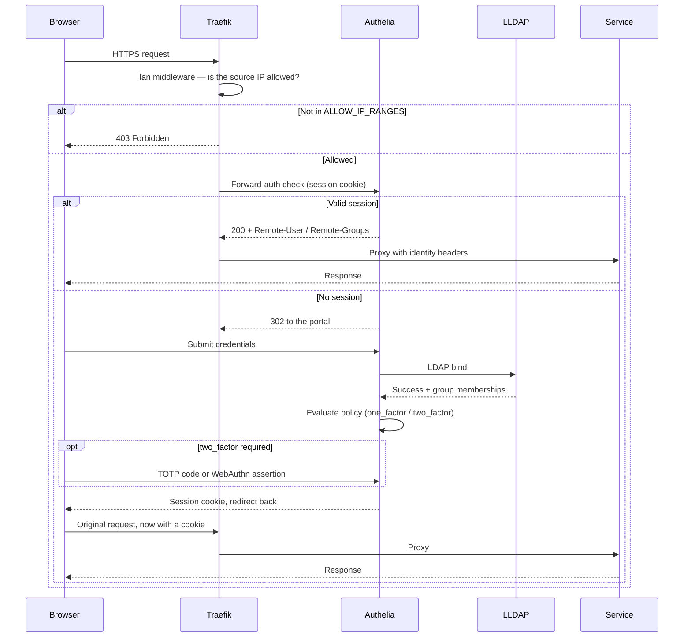
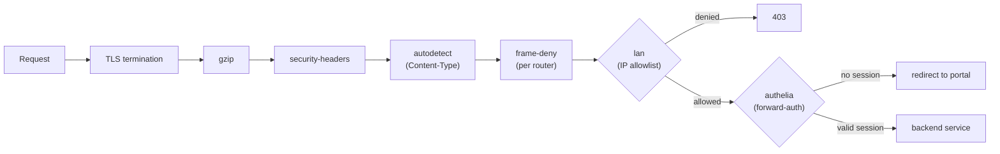

# Security & Authentication

To report a vulnerability, see the [security policy](../.github/SECURITY.md).

Five layers, in the order a request meets them:

1. **Nothing web-facing is exposed but Traefik** — `443/tcp` and `443/udp` (HTTP/3), with `80/tcp` only redirecting; the DNS-challenge certificates mean port 80 never has to be reachable from the internet. The host also publishes DNS (`53/tcp+udp`, Pi-hole) and the VPN's own UDP ports (`3478`, `41641`) — see [Networking → Ports](NETWORKING.md#ports).
2. **IP allowlist** (`lan` middleware) — only your LAN, your tailnet and the Docker networks reach a service at all.
3. **VPN mesh** — remote access happens over WireGuard, not over an opened port.
4. **SSO** — Authelia, either as forward-auth or as an OIDC provider.
5. **LLDAP** — one directory of users and groups, the single source of truth for both.

The deliberate exceptions to layer 2 — the Authelia portal, Headscale, and the public share and addon paths of a few services — are listed in [Per-service protection](#per-service-protection), each with its reason.

## How a login works

Which mechanism applies to which service is in [Per-service protection](#per-service-protection).

### Forward-auth — for services with no login of their own



### OIDC — for services that can authenticate themselves

Standard authorization-code flow: the service redirects to Authelia's `/authorize`, Authelia authenticates the user against LLDAP (reusing an existing session if there is one), redirects back with a code, and the service exchanges it server-to-server for an ID token — a JWT signed RS256 with the key in `oidc_private_key.pem`. The service verifies the signature and provisions or updates the local user from the claims.

Two consequences specific to this stack: **group membership travels in the `groups` claim**, which is how the clients that request that scope (see the client table below) map the LLDAP `admin` group onto their own roles; and the token exchange is a *container-to-container* call, which is why the Authelia router carries no IP allowlist ([below](#the-middleware-chain)).

**The `groups` claim is not in the ID Token, and it must not be put there.** Authelia's ID Token carries only what proves authorization happened; `groups`, `email`, `name` and `preferred_username` are served from the UserInfo endpoint, or through the standard claims parameter, which Authelia honours for any claim the client could reach by scope. Every client here reads them one of those two ways (Homepage reads neither and needs neither), so the template declares **no `claims_policies`**. Leave the `id_token` escape hatch in that block unused: Authelia's own documentation calls it a break-glass measure for clients with a bug.

**Logging out is not an OIDC operation here.** Authelia implements none of the OIDC logout mechanisms (RP-initiated, front-channel or back-channel), so its discovery document carries no `end_session_endpoint`, and a client that falls back to its own root lands on a still-valid portal session that signs the user straight back in. The five clients that expose a logout URL point at Authelia's *portal* logout route instead, with an `rd` back to their own login page: the browser carries the session cookie there, so the session genuinely ends — for every SSO service at once. Redirect targets sit under the session cookie domain, which is what passes Authelia's `safe-redirection` check.

Nextcloud's URL ends in an odd-looking `&ignored=`, and it is load-bearing: `user_oidc` appends `?post_logout_redirect_uri=…&client_id=…` unconditionally, and without a parameter to absorb it that second `?` lands inside the `rd` value and corrupts it.

| Client | Where the logout URL lives | Set in |
|--------|---------------------------|--------|
| **Nextcloud** | `user_oidc` provider `endSessionEndpoint` | `scripts/nextcloud-oidc-bootstrap.sh` |
| **Audiobookshelf** | `authOpenIDLogoutURL` auth setting | `scripts/audiobookshelf-bootstrap.sh` |
| **Immich** | `oauth.endSessionEndpoint` (takes precedence over discovery) | `config/immich/oauth-config.yaml.template` |
| **Open WebUI** | `WEBUI_AUTH_SIGNOUT_REDIRECT_URL` | `compose/compose-ai.yaml` |
| **Grafana** | `GF_AUTH_SIGNOUT_REDIRECT_URL` | `compose/compose-monitoring.yaml` |

The remaining clients have nowhere to put one, so signing out of them leaves the portal session standing and the next visit signs the user back in: Kavita, Beszel, Dockhand and Headplane expose no such field, Shelfmark has no logout handling of its own, Trilium's post-logout redirect is fixed to its own `/login`, and Vaultwarden offers no override (its session is its own anyway, under `SSO_AUTH_ONLY_NOT_SESSION`). Homepage hardcodes its sign-out redirect to `/auth/signin?autologin=0`, and Grafana's `rd` ends in `%2Flogin%3FdisableAutoLogin`: both auto-login, so a bare login page would sign the user straight back in. Headscale holds no browser session, only device registrations.

**The LDAP bind is tuned for a busy host, not a fast one.** `authentication_backend.ldap` raises `timeout` to `15s` and enables `pooling` (5 connections, 2 retries, `10s` to get a connection). Authelia's 5-second default is shorter than an I/O stall on a host under swap pressure, and a bind that times out *during* a token grant reaches the client as a `500` — for a refresh grant, the loss of the token it was rotating. Pooling turns a transient stall into a retry. The cost: `timeout` covers every LDAP operation, so with LLDAP wedged a forward-auth request can hang ~25 s before failing, while Authelia's `/api/health` (which touches no LDAP) and its Uptime Kuma monitor stay green. To fail fast instead, lower `timeout` and keep `pooling`.

**Registered clients** — all `consent_mode: implicit`, defined in `config/authelia/configuration.yml.template`, whose comments beside each client record why its auth method, PKCE setting and scopes are what they are:

| Client | Scopes | Auth method | Policy | Notes |
|--------|--------|-------------|--------|-------|
| **Nextcloud** | openid profile email groups offline_access | client_secret_post | one_factor | Group provisioning enabled |
| **Immich** | openid profile email groups | client_secret_post | one_factor | Mobile app callback; `roleClaim` reads `groups`, so `admin` promotes *and* demotes on every login |
| **Beszel** | openid profile email | client_secret_basic | one_factor | PKCE (S256) required |
| **Dockhand** | openid profile email groups | client_secret_post | **admin_only** | 2FA + `admin` group |
| **Headplane** | openid profile email offline_access | client_secret_basic | **admin_only** | 2FA + `admin` group |
| **Headscale** | openid profile email | client_secret_basic | one_factor | VPN device registration |
| **Open WebUI** | openid profile email | client_secret_basic | one_factor | — |
| **Agentgateway** | openid profile email | client_secret_basic | **admin_only** | 2FA + `admin` group. PKCE (S256) required |
| **Vaultwarden** | openid profile email offline_access | client_secret_basic | one_factor | Master password still required |
| **Shelfmark** | openid profile email groups | client_secret_basic | one_factor | PKCE (S256) required; admin comes from the `admin` group; local login disabled |
| **AIOStreams** | openid profile email groups | client_secret_post | one_factor | PKCE (S256) required. `groups` is what makes it deny-by-default (`AIOSTREAMS_OIDC_GROUP_PERMISSIONS`): without the scope nobody can sign in, admin included |
| **AIOMetadata** | openid profile email groups | client_secret_basic | one_factor | PKCE (S256) required. Same deny-by-default group mapping (`OIDC_GROUP_PERMISSIONS`) |
| **Kavita** | openid profile email offline_access | client_secret_post | one_factor | **no `groups` scope** — role sync is off, so the claim would be ignored; roles come from `DefaultRoles` and admin is set in Kavita |
| **Audiobookshelf** | openid profile email | client_secret_basic | one_factor | PKCE (S256) required; **no `groups` scope** — it reads the claim as a role and denies anyone outside admin/user/guest |
| **FreshRSS** | openid profile email | client_secret_basic | one_factor | PKCE (S256) required; the flow runs in Apache (`mod_auth_openidc`), not in FreshRSS. **No `groups` scope** — FreshRSS derives no roles from the token, so `one_factor` is the whole access decision |
| **Trilium** | openid profile email | client_secret_basic | one_factor | PKCE (S256) required. **No `groups` scope** — it has no roles. `one_factor` is not the last gate: Trilium binds the first `sub` that enrolls and rejects every other one, so it is single-owner regardless of who else passes the policy |
| **Forgejo** | openid profile email groups | client_secret_basic | one_factor | PKCE (S256) required. `groups` **is** read: the auth source is created with `--group-claim-name groups --admin-group admin`, and Forgejo re-evaluates administrator status from that claim on every sign-in, so promoting someone is an LLDAP change. Without the scope nobody is ever an admin, including the first account |
| **Tuwunel** | openid profile email | client_secret_post | one_factor | PKCE (S256) required. One redirect URI serves both Element Web's SSO and Element X's next-gen auth. **No `groups` scope**: the server admin is whoever signs in first (`grant_admin_to_first_user`). The Matrix localpart is `preferred_username`, the LLDAP uid; `UNIQUE_ID_FALLBACKS=false` refuses a sign-in without one |
| **Grafana** | openid profile email groups | client_secret_basic | **admin_only** | 2FA + `admin` group. PKCE (S256) required. `role_attribute_path` maps the `admin` group onto Grafana's Admin role and everyone else onto Viewer — a fail-safe behind two gates that already require it. Keep `client_secret_basic`: Grafana tries it first, so `post` would fail every first token exchange and raise a spurious "OIDC grant rejected" alert |
| **Homepage** | openid profile email | client_secret_basic | one_factor | PKCE (S256) required. **No `groups` scope** — Homepage has no roles, so `one_factor` is the whole access decision. Keeps forward-auth *as well* — see the matrix below |

`admin_only` is a named policy in the template: deny by default, `two_factor` for members of the `admin` group.

## Per-service protection

| Service | `lan` | `authelia` | Own OIDC | Effective protection |
|---------|:---:|:---:|:---:|----------|
| Authelia portal | — | — | — | Public login entry point. No IP restriction so OIDC clients can reach it server-side; `rate-limit-portal` caps request floods and Authelia's own `regulation` handles brute force — see [below](#the-middleware-chain) |
| Headscale | — | — | ✓ | Public by necessity — VPN clients register from anywhere. Bare `/` is a 302 to `/admin` (`headscale-root` + `headscale-root-redirect`), which is Headplane's own router: separately LAN-only + SSO + 2FA. The redirect hands the browser to that router rather than rewriting the path onto the headscale service, which has no `/admin` |
| Nextcloud | ✓ | — | ✓ | LAN-only + OIDC; a second router, `nextcloud-public`, leaves open only what a public share page loads: `/s/`, `/public.php`, the public preview, the CalDAV paths under `/remote.php/dav/calendars/` and `/remote.php/dav/public-calendars/`, and assets under `/apps`, `/custom_apps` and `/core` restricted to their asset subdirectories (`css`, `js`, `img`, `l10n`, …) — never an app's REST surface, and never `/ocs/`. `/custom_apps/` is where store-installed apps such as Calendar serve those assets. Avatars are narrowed to `/avatar/guest/`, the only one a share requests: any other avatar path tells an existing account from an unknown one, unauthenticated — an account-enumeration oracle. Its `files_external` mounts are **read-write**, so an account in the `admin` group can delete or move anything in the download and library tree — see [Architecture](ARCHITECTURE.md#the-reading-libraries) |
| Immich | ✓ | — | ✓ | LAN-only + OIDC only; password login disabled in `config/immich/oauth-config.yaml.template`, so the shared `PASSWORD` is not a way past Authelia into everyone's photos. Re-enable by flipping `passwordLogin.enabled` and restarting — Immich refuses to let the UI override a config file. `immich-public` leaves the share paths open on `rate-limit-burst`, since a share page pulls one thumbnail per photo: `/share`, `/s/`, `/_app`, three loose root files, the three `/api/server/*` config endpoints, and `/api/assets`, `/api/download`, `/api/timeline` and `/api/albums` *only* with a `key` or `slug` parameter — never a blanket `/api`. `immich-share-auth` takes the two credential endpoints (`/api/shared-links/me`, `/api/shared-links/login`) onto `immich-share-limit` — 30 per minute, burst 20, bucketed per IPv6 /64; they are removed from the public rule, so the split fails closed if that router ever stops loading. Immich itself does not throttle share passwords, and has no setting for it |
| Vaultwarden | ✓ | — | ✓ | LAN-only + OIDC + master password — see [below](#vaultwarden). Off `frontend`, on the two-member `vaultwarden_web` segment with Traefik: nothing else has any reason to open `:80` on the vault |
| Beszel | ✓ | — | ✓ | LAN-only + OIDC, password login disabled. The agent's WebSocket (`/api/beszel/agent-connect`) uses this same router: `beszel-agent` is `network_mode: host` and pins `beszel.<HOST_NAME>` to `HOST_LAN_IP` with `extra_hosts`, so it arrives from the host's own LAN address, on the static part of the allowlist. A *remote* agent would need a public router for that path, with a limiter |
| Open WebUI | ✓ | — | ✓ | LAN-only + OIDC |
| Agentgateway | ✓ | — | ✓ | LAN-only + OIDC + admin + 2FA on the UI, run by the gateway itself (`ui.policies.oidc`) because a forward-auth would intercept its `/oauth/callback`. That covers the UI **only**: `/v1` and the provider routes need an API key (401 without), `/mcp` a separate one, and an MCP target added through the UI has no policy until one is attached — see [Local AI](AI.md#three-surfaces-three-different-gates) |
| Dockhand | ✓ | — | ✓ | LAN-only + OIDC + admin + 2FA, local login disabled. Off `frontend`, on the two-member `dockhand` segment with Traefik: it reads the Docker socket, so reaching `:3000` from a neighbour would be a path to every container on the host. Uptime Kuma watches it over `docker.sock`, not over HTTP; `dockhand-oidc-bootstrap.sh` and `rotate-password.sh` set `DOCKER_CURL_NETWORK` to join that segment |
| Headplane | ✓ | ✓ | ✓ | LAN-only + SSO + OIDC + admin + 2FA. Its two static WebAssembly files (`/wasm_exec.js`, `/hp_ssh.wasm`) are served without the allowlist by `headplane-wasm`, rewritten onto `/admin/` |
| Kavita | ✓ | — | ✓ | LAN-only + own accounts / OIDC — OPDS clients can't pass an interactive portal |
| Shelfmark | ✓ | — | ✓ | LAN-only + OIDC only; password login disabled (`DISABLE_LOCAL_AUTH`), so requests and download history stay per-user |
| Audiobookshelf | ✓ | — | ✓ | LAN-only + OIDC only; local login disabled once the bootstrap holds an API key, so the shared `PASSWORD` is not a second way into everyone's listening history. No forward-auth: the mobile apps can't pass an interactive portal, and they have their own OIDC redirect URI |
| FreshRSS | ✓ | — | ✓ | LAN-only + OIDC. Apache's `mod_auth_openidc` guards `/i/` (the whole web UI) and maps `preferred_username` onto a per-user FreshRSS account, auto-created on first sign-in — so Authelia's `one_factor` policy decides who has a reading list at all. `/api/greader.php` is deliberately outside that: feed-reader apps can't pass an interactive portal, and it checks the account's own API password. No forward-auth for the same reason |
| Forgejo | ✓ | — | ✓ | LAN-only + OIDC. Accounts come from LLDAP only (`ALLOW_ONLY_EXTERNAL_REGISTRATION`), created on first sign-in. No forward-auth: `git clone`/`git push` over HTTPS and `/api/v1` send a personal access token over basic auth and can't pass an interactive portal — which is also why `ENABLE_BASIC_AUTHENTICATION` is left on. `REQUIRE_SIGNIN_VIEW=true` closes anonymous *browsing*, which would otherwise let anyone on the LAN or tailnet read every repository; the healthcheck endpoint (`/api/healthz`) is exempt from it. Git-over-SSH is off: it would need a published host port |
| Tuwunel + Element (`chat.`) | ✓ | — | ✓ | LAN-only + OIDC. Element Web on `/`; the Matrix API on `/_matrix`, `/_tuwunel`, `/.well-known/matrix` and `/.well-known/openid-configuration`. No forward-auth: Element clients authenticate every API call with a Matrix access token. **Federation is off** and password registration is off — accounts come from LLDAP on the first SSO sign-in. Password *login* stays on for bot accounts, which `scripts/openclaw-bootstrap.py` registers through `/_synapse/admin/v1/register` with a shared HMAC secret in `${DATA_LOCATION}/tuwunel-secrets/`: that endpoint bypasses the closed registration, so Traefik routes no `/_synapse` path and the secret is worth an admin token. Element's `config.json` disables integration managers, the identity server, guests and account deactivation. Tuwunel runs with a read-only root filesystem and every capability dropped but `DAC_READ_SEARCH`. `element-frame` sends `SAMEORIGIN`, because `DENY` would break Element's own iframes |
| OpenClaw (`@assistant`) | — | — | — | Not routed: no Traefik router, no published port; its gateway listens on loopback inside the container behind a token, Control UI and terminal off. Reached only as a Matrix account answering an exact allowlist of LLDAP accounts — in DMs, and when mentioned in the one family room the bootstrap creates. It holds no tool that executes, browses or fetches, its config is mounted read-only, and both its networks (`ai`, `assistant`) are internal. Each person's agent reaches only that person's Nextcloud, able to read and add files but never delete or replace one. See [Local AI](AI.md#the-family-assistant-openclaw) |
| SearXNG | ✓ | — | — | LAN-only and nothing else: SearXNG has no accounts and keeps nothing per user — no stored credential, no query history. Open WebUI, OpenClaw and Homepage call it directly at `searxng:8080`, not through Traefik. `enable_metrics: true` keeps per-engine timings and the last error context of each (hostname only, never the query text); `/metrics` stays 404, since `open_metrics` (which would have to carry a password) is not set |
| Trilium | ✓ | — | ✓ | LAN-only + its own account / OIDC. No forward-auth: `/etapi` (scripting) and `/api/clipper` (the Web Clipper extension) can't pass an interactive portal. SSO is **not** live until the owner enrolls it — see below |
| changedetection.io | ✓ | ✓ | — | LAN-only + SSO. No OIDC upstream, and its own password is a single shared one in the datastore, so forward-auth is the gate and that password is left unset — see [below](#changedetectionio-fetches-whatever-it-is-told-to). Its `/api/v1` is inside the same gate; the Homepage widget does not go through Traefik at all, it dials `pi-changedetection:5000` over `frontend` with the datastore's API token |
| n8n | ✓ | — | — | LAN-only + its own auth |
| ntfy | ✓ | — | — | LAN-only + its own accounts and ACLs (`deny-all` default) |
| Homepage | ✓ | ✓ | ✓ | LAN-only + SSO + its own OIDC. `HOMEPAGE_OIDC_AUTO_LOGIN=true` sends an unauthenticated visitor straight to Authelia, whose session the forward-auth hop has already established, so the dashboard opens in one hop. Stacking is not redundant: forward-auth guards only the Traefik path, while `/api/*` — which proxies every widget's credentials — is reachable from anything on `frontend` that dials `:3000` with a forged `Host: homepage.<HOST_NAME>`, which is all `HOMEPAGE_ALLOWED_HOSTS` checks. `/api/healthcheck` and `/api/config/custom.css` stay public by design |
| Grafana | ✓ | ✓ | ✓ | LAN-only + SSO + OIDC + admin + 2FA. Both layers, as with Homepage: the dashboards carry per-caller LLM spend and Authelia's failure counts, and `/api` is reachable from anything on `frontend` that dials `:3000`. `GF_AUTH_GENERIC_OAUTH_AUTO_LOGIN=true` skips the lone sign-in button. The built-in admin account is inert — `GF_AUTH_BASIC_ENABLED=false` as well as `GF_AUTH_DISABLE_LOGIN_FORM=true`, because the API accepts HTTP basic auth regardless of the form — so no `PASSWORD` is injected. On `frontend` only: it dials nothing but `prometheus:9090`, and `ai` would give it a path to system-tools and the Docker socket |
| Prometheus | — | — | — | **Not routed at all**: no Traefik labels, no router, no `expose`. Its query API is unauthenticated, so the access control is that only containers on `frontend` and `ai` can reach `:9090`, and Grafana is the only one that does |
| Uptime Kuma | ✓ | ✓ | — | LAN-only + SSO |
| qBittorrent | ✓ | ✓ | — | LAN-only + SSO |
| Prowlarr / Kapowarr | ✓ | ✓ | — | LAN-only + SSO |
| Traefik dashboard | ✓ | ✓ | — | LAN-only + admin + 2FA (the `traefik.<HOST_NAME>` router on `websecure`) |
| Traefik API (`:8080`) | — | — | — | Not on `websecure` at all: the `internalapi` router serves `api@internal` on Traefik's implicit `traefik` entrypoint, reachable only inside `frontend`. `/api/rawdata` returns the full router map, including every public-bypass rule, so it carries `internalapi-allow` — an `ipallowlist` of `172.30.11.240/32`, Homepage's static address and its only consumer |
| Pi-hole | ✓ | ✓ | — | LAN-only + admin + 2FA. The admin UI binds to `127.0.0.1:8082` and `172.30.11.241:8082` only, never `0.0.0.0`: Pi-hole also sits on the `lan` macvlan, where Docker's publishing rules do not apply, so a wildcard bind would serve the whole LAN (and, through the advertised subnet route, the tailnet) at `${PIHOLE_IP}:8082` behind `PASSWORD` alone, bypassing this row. Loopback is for `scripts/pihole-bootstrap.sh`; `172.30.11.241` is what Traefik dials |
| Backrest | ✓ | ✓ | — | LAN-only + admin + 2FA + **its own login**, whose password is per-service (`config/backrest/backrest.env`), not `${PASSWORD}` — the API hands the restic repository password and the S3 keys to any *authenticated* caller, and forward-auth only guards the Traefik path, not the container network. Which is why Backrest is also off `frontend`, on the dedicated `backup` segment: only Traefik and Homepage can open `:9898` at all |
| Gluetun HTTP proxy | — | — | — | Not routed through Traefik at all. `gluetun:8888` is unauthenticated and reachable by anything on `frontend` — gluetun's firewall accepts the whole Docker network by design. Enabled for Shelfmark's direct downloads; the exposure is VPN egress for a container that already has internet, not a path to data |
| LLDAP | ✓ | ✓ | — | LAN-only + 2FA + its own auth + `rate-limit-auth` |
| Stremio | ✓ | — | — | LAN-only; streaming clients and cast receivers can't do the portal |
| StremThru | ✓ | partial | — | Two routers, and it is the **catch-all** that carries forward-auth: SideKick, the dashboard, every configure page, `/v0/store/*` and `/v0/torznab/api` are browser or operator surfaces with no headless caller. `stremthru-addon` takes `/stremio/torz` minus any `/configure` path (the per-userdata configure page included) and drops `authelia@docker`, because AIOStreams fetches the manifest and streams server-side and cannot pass a login — forward-auth there would fail silently, as a shorter stream list. **Both stay behind `lan@docker`**: AIOStreams reaches the addon over `frontend`, and in a store mode torz encodes a debrid token into the stream URLs it builds. The `p2p` store code returns infoHash-only results with no credential in them, and is the recommended mode. `STREMTHRU_FEATURE` is an allowlist, so Wrap, Store, List, Newz, usenet, SABnzbd and WebDAV stay off. The `vault` feature, which would store a Stremio account server-side, is off only because `STREMTHRU_VAULT_SECRET` is empty — setting that variable turns it on; until then SideKick keeps the Stremio `authKey` in an HttpOnly/Secure cookie |
| AIOStreams | partial | — | ✓ | Three routers: a LAN-only catch-all, a public addon half on `rate-limit-auth` and a public catalogue half on `rate-limit-burst`. Public paths are `/stremio/<uuid>/<encryptedPassword>/*` — that URL *is* the credential — minus every `/configure` page; `/api/v1/debrid/playback/*`, the link Stremio follows to play a stream (a 307 to the debrid CDN, its blob encrypted with `SECRET_KEY`); and the `/static/*` status clips. The rest of `/api/v1/*` stays LAN-only, so enabling the built-in proxy or usenet means revisiting the rule: their playback URLs are not matched. No forward-auth: Stremio fetches manifests programmatically, and the operator surface has Authelia through OIDC, deny-by-default by group, with `AIOSTREAMS_AUTH_REQUIRED=true`. `rate-limit-auth` caps the stream path, where each request fans out to a dozen addons and a debrid API from the host's WAN IP. Local login is **off** (`AIOSTREAMS_OIDC_ALLOW_LOCAL_LOGIN=false`); the `AIOSTREAMS_AUTH` account survives only as the HTTP Basic credential of the built-in proxy and usenet engine. Disabling OIDC does **not** bring the login form back: if Authelia is down, set that flag to `true` in `compose/compose-media.yaml` and `up -d` |
| AIOMetadata | partial | — | ✓ | Same three-router split. The addon protocol (`/stremio/<uuid>/*`) is public on `rate-limit-auth`, capping the fan-out each catalog page triggers to TMDB, TVDB and MDBList; the artwork routes (`/poster*`, `/logo*`, `/background*`, `/missing_poster.png`) are public on `rate-limit-burst`, because a Stremio home screen requests over a thousand images. The artwork route is an image proxy anyone holding an addon URL can aim at the internet, hence a limit at all, and `POSTER_PROXY_ALLOW_PRIVATE=false` stops it being aimed *inward*. `/dashboard`, `/api/*` and every configure page stay LAN-only. Its own OIDC gates the operator surface (`AUTH_REQUIRE_SIGNIN=true`). `ADMIN_KEY` is the bypass when the provider is unreachable, and also signs the artwork-proxy URLs. Provider API keys go in `config/aiometadata/api-keys.env` as `BUILT_IN_*` — never the bare names, which `/api/config` serves to every visitor even with sign-in required |

Services with their own account system (Immich, Kavita, Shelfmark, Audiobookshelf, FreshRSS, Trilium, Forgejo, Tuwunel) deliberately do **not** stack forward-auth on top of OIDC — their apps and clients cannot complete an interactive portal. Homepage, Headplane and Grafana stack both: they are only ever opened in a browser, which completes both hops.

### Trilium's SSO has to be enrolled by hand, once

Trilium is the one OIDC client whose *enrollment* no script performs, because none can: binding an identity requires a browser session that is already signed in as the owner. `scripts/trilium-pre-start.sh` prepares the client secret, and the environment variables make the option available — the last step is yours.

On a fresh install:

1. Nothing, normally: `scripts/trilium-bootstrap.sh` has already created the document (without the demo notes) and set the owner password to `${PASSWORD}` on the first start, which closes the window in which whoever reached the instance first would have become its owner. Kavita still has that window — see [Installation](INSTALLATION.md#4-kavita--one-manual-step). Change the password afterwards if you want: the stack only needs it until step 3.
2. Sign in with that password, then go to *Options → MFA* and choose OpenID as the method. That is what arms the flow; the environment variables alone do not.
3. Click through to Authelia and back. That round-trip is the enrollment: Trilium stores the `sub` it receives and, from then on, refuses every other one with `wrong_account`.

Enrolling from an anonymous session is refused, so a stranger cannot claim the instance by being the first to authenticate, and before enrollment the login page keeps offering the password form, so a misconfigured provider cannot lock the owner out.

Step 2 is also the point of no return for automation: once OpenID is the method and a subject is bound, `POST /login` stops checking passwords and redirects to Authelia, so nothing can script a session again. That is why the bootstrap writes the AI and MCP options *before* this step, and why they have to be set by hand afterwards — see [Local AI](AI.md#trilium-on-both-sides-of-the-gateway).

That binding is what makes `one_factor` an adequate policy here: Trilium is single-owner, so there is no second account to authorize. Logout is local only, as described under [OIDC](#oidc--for-services-that-can-authenticate-themselves).

### changedetection.io fetches whatever it is told to

It is the only service in the stack whose *purpose* is to open arbitrary URLs from inside the Docker networks, and it sits on `frontend` because outbound HTTP to any host is the job and an internal segment would break it. Two things keep that from being a server-side request forgery primitive:

- **`ALLOW_IANA_RESTRICTED_ADDRESSES=false`** in `compose/compose-knowledge.yaml`. Upstream resolves every watch URL — and every Apprise notification target routed through its own `post://`/`get://` handlers — and refuses any hostname that lands on a private, loopback, link-local, multicast or otherwise non-globally-reachable address. So `http://pi-postgres:5432` and a LAN router's admin page are both rejected, by name or by address. The check runs on the fetch itself, not only when the watch is saved, and the plain-HTTP fetcher — the only one deployed here — re-checks every redirect hop. It is upstream's default, pinned because it is load-bearing: flipping it to watch a LAN page also hands every watch, and anyone who can add one, the whole `frontend` segment.
- **`ALLOW_FILE_URI`** is left at its default `False`, so `file:///` watches — which would read the container's own filesystem, including `/datastore` — are refused.

The ntfy route is the one private target that works, deliberately: it uses Apprise's built-in `ntfy://` plugin, which the SSRF check does not cover, over `frontend`, where ntfy also sits. It is **not** put on the internal `ntfy` segment, which exists so Backrest and Dockhand can reach ntfy *without* joining `frontend`: joining it would hand the one container built to fetch attacker-chosen URLs a route to Backrest's `:9898` (the restic password and the S3 keys) and Dockhand's `:3000`. Its credential is a per-service ntfy token with `rw` on the `watches` topic only, so it cannot publish a fake outage or security alert.

The same gate is why the LLM features are switched off with `LLM_FEATURES_DISABLED=true` rather than pointed at the stack's own models: the LLM API base URL goes through it too, so reaching `agentgateway` on an internal address would mean opening the SSRF gate for every watch as well.

Its own password field in *Settings → General* is deliberately left empty: it is a single shared password with no accounts behind it, and setting one would put a second login in front of a router Authelia already gates. The healthcheck tolerates one being set anyway (`config/changedetection/healthcheck.py`) rather than reporting an outage.

## The middleware chain

Every request through Traefik:



**Security headers**, on the `websecure` entrypoint:

| Header | Value | Why |
|--------|-------|-----|
| `Strict-Transport-Security` | `max-age=15552000; includeSubDomains` | Force HTTPS for 180 days |
| `X-Content-Type-Options` | `nosniff` | MIME sniffing |
| `Referrer-Policy` | `same-origin` | Referrer leakage |

**`nosniff` needs something to sniff-proof.** Traefik v3 [does not fill in a missing
`Content-Type`](https://doc.traefik.io/traefik/migrate/v2-to-v3-details/), and the `lan` 403 sets
none — so `nosniff` leaves a WebKit browser nothing to render and it downloads the denial as a
file. `autodetect` fills in a `Content-Type` only when it is absent, never overriding a backend's
own; it is listed **last** on the entrypoint so it wraps the router middlewares that write such
responses.

**`X-Frame-Options` is separate, and per router.** An entrypoint middleware wraps every router's own middlewares, so its response headers win and no router could opt out — and some must. So the policy lives in a standalone `frame-deny` middleware (`DENY`) that routers list themselves. Services that frame their own pages list a `SAMEORIGIN` middleware of their own instead — `nextcloud-frame`, `trilium-frame`, `element-frame` and `vaultwarden-frame` — and Vaultwarden's connector router carries no frame header at all (see [Vaultwarden](#vaultwarden)).

List the frame middleware **first** in a router's chain. Middlewares listed later sit further inside, and anything that short-circuits — the `lan` 403, an Authelia portal redirect, the Stremio redirect — returns without reaching them, so a frame middleware placed last silently omits the header on exactly those responses. Adding a new router means adding it there too; nothing enforces this automatically.

**Rate limiting** — `rate-limit-auth` (10 req/s average per source IP, burst 20, period 1 s) is on three routers: `lldap`, where it sits *before* the forward-auth middleware and blunts credential stuffing, and `aiostreams-public` and `aiometadata-public`, where it caps the upstream fan-out (see those rows above). `rate-limit-burst` (100 req/s, burst 200) is the deliberately looser sibling, on `aiometadata-art` and `aiostreams-catalog`: artwork comes off a local disk cache, a catalogue page off a 5-minute cache and AIOStreams' `/static/*` status clips off local disk, none costing anything upstream, while a single Stremio home paint asks for over a thousand images and dozens of catalogues. `rate-limit-auth` stays on the *stream* path, which is the request that fans out to a dozen addons and a debrid API. `immich-public` is on `rate-limit-burst` for the same reason the artwork routes are. `rate-limit-portal` (20 req/s, burst 60) is the SSO portal's own, on the `authelia` router: a cold load of the portal fires 21 requests at once, so `rate-limit-auth`'s burst of 20 would refuse one of the chunks the login form needs. It caps a flood; guessing is left to Authelia's `regulation`. A third, service-local middleware exists because neither sibling fits a password field: `immich-share-limit` (30 per minute, burst 20, `ipStrategy.ipv6Subnet=64`) is on `immich-share-auth` alone, and it is the only limiter here sized against guessing rather than against upstream cost — hence the minute-long period and the /64 bucket, without which a per-IP limiter is decorative against a client that can pick a fresh address per request. Traefik is only half the story: AIOStreams rate-limits its own Stremio surfaces too, which is why `STREMIO_CATALOG_RATE_LIMIT_MAX_REQUESTS` is raised from its default of 30 per 5 s.

**The Authelia portal has no allowlist, and a limiter of its own.** It must answer from anywhere: a device registering with Headscale signs in here before it is on the tailnet, and OIDC clients (Open WebUI, Nextcloud, Immich…) make *server-side* calls to its discovery and token endpoints. `rate-limit-auth` would break its SPA, which loads a burst of assets at once, so the router carries `rate-limit-portal` (20 req/s average, burst 60): it caps floods, not guesses. Brute force is handled by Authelia's own `regulation` block: `max_retries: 3` within `find_time: 2m`, then `ban_time: 5m`, applied in both modes — `user` and `ip`. IP mode is only sound because Traefik trusts no forwarded header (below); if it trusted the client's own `X-Forwarded-For`, a per-IP ban could be evaded by changing a header. `user` mode alone would let one address spray many usernames, locking each account for five minutes without ever slowing the caller down.

**Cookie forwarding.** The `authelia` middleware sets `authRequestHeaders=Accept,Cookie,Authorization` so Traefik passes the session cookie on every protected request. Without it, Authelia cannot find the session in Redis and returns a "user state" error.

**Traefik trusts no forwarded header, and neither does the authz call.** Nothing proxies in front of Traefik, so every `X-Forwarded-*` arriving on `websecure` is client-supplied — the entrypoint therefore declares no `forwardedHeaders.trustedIPs` at all. Pairing that with `forwardauth.trustForwardHeader=false` makes Traefik derive the Method/Proto/Host/URI it sends Authelia from the request it actually received. Trusting them would let any LAN or tailnet client send an `X-Forwarded-Host` naming a laxer domain and have Authelia evaluate *that* domain's rule for a request aimed at a gated service.

## Access-control policies

Authelia's rules in evaluation order (`config/authelia/configuration.yml.template`, default policy **deny**):

| Domain | Subject | Policy |
|--------|---------|--------|
| `auth.*` | — | bypass (the portal itself) |
| `uptime.*`, `homepage.*`, `qbittorrent.*`, `prowlarr.*`, `kapowarr.*`, `ai.*`, `stremthru.*`, `changes.*` | any user | one_factor |
| `headscale.*` path `/admin` | `admin` group | two_factor |
| `backrest.*`, `pihole.*`, `traefik.*`, `lldap.*`, `grafana.*` | `admin` group | two_factor |
| anything else | — | **deny** |

**Nothing may follow the `admin` row for those five domains.** Rules are first-match, and a `subject` the user does not satisfy is not a match — so a bare `two_factor` rule for `lldap.*` below it would let *every* account into the directory UI and make the admin gate above decorative. A user who needs to change their own password uses LLDAP's reset mail (`LLDAP_SMTP_OPTIONS__ENABLE_PASSWORD_RESET`), not the UI.

**`admin` is the only group that means anything here.** Create it in the LLDAP UI and add your admin accounts; regular users need no group. The deny catch-all applies only to routers carrying the `authelia` middleware — OIDC services enforce their own policy from the client table above.

Two things follow from having exactly one group, and both are load-bearing:

- **LLDAP's own `lldap_*` groups are filtered out of the claim.** `lldap_admin`, `lldap_password_manager` and `lldap_strict_readonly` are the directory's *permission* model, not application roles; unfiltered, they would travel to every client that asks for the scope, and Nextcloud would provision them as real groups. `groups_filter` is therefore `(&(member={dn})(!(cn=lldap_*)))`. Keep regular accounts out of `lldap_strict_readonly` regardless: it grants read access to the whole directory and is not needed to change one's own password.
- **`admin` *is* Nextcloud's superuser group.** Nextcloud's built-in administrators group is called `admin`, so group provisioning maps the LLDAP group straight onto it — adding someone to `admin` to give them a Kavita or Dockhand admin makes them a Nextcloud server administrator too, with write access to the whole library tree through `files_external`. If a per-service admin is ever needed, it needs its own group, not this one.

## Two-factor authentication

Enforced on every admin surface: Traefik, Pi-hole, Backrest, LLDAP, Grafana and Headplane through the forward-auth rules, plus Dockhand, Headplane, Agentgateway and Grafana through the `admin_only` OIDC policy.

Users enrol at the Authelia portal under **Security**, with **TOTP** (any authenticator app) or **WebAuthn** (FIDO2 keys, platform authenticators). Save the backup codes.

## Vaultwarden

Served at `https://vault.<HOST_NAME>`. Its data lives in the shared PostgreSQL instance (database and role `vaultwarden`, created by `config/postgres/init-databases.sh`), so it is dumped by `scripts/db-backup.sh vaultwarden` from a Backrest snapshot hook like every other database here. Only attachments, sends and the RSA signing key stay on disk, in `${DATA_LOCATION}/vaultwarden`. It reaches PostgreSQL over its own internal `vault` network, which deliberately does not include LLDAP.

**Accounts.** `SIGNUPS_ALLOWED` is `false`: the router sits behind the LAN allowlist only, so open registration would let anyone on the LAN or the tailnet create a vault. `INVITATIONS_ALLOWED` stays `true`, and `ADMIN_TOKEN` is set, so `/admin` is where you invite people. Read the token with:

```bash
sudo cat ${DATA_LOCATION}/authelia-config/secrets/vaultwarden_admin_token
```

**The admin token is not `PASSWORD`.** `scripts/vaultwarden-pre-start.sh` generates a random token on first start and hands the container only its Argon2id digest, so the plaintext never appears in `compose/compose-cloud.yaml`, the container's environment or `docker inspect`. That matters because `/admin` inherits this router's middleware — the LAN allowlist and nothing else, no Authelia forward-auth — so reusing the SSO password would make a `PASSWORD` leak an admin-panel compromise as well. `rotate-password.sh` deliberately leaves it alone; rotate it with `make rotate-secret TARGET=vaultwarden`.

**Frame headers.** Vaultwarden sets its own `X-Frame-Options` and CSP, and its `/admin` diagnostics validate them end to end — so a reverse proxy that overwrites them shows up there as an `HTTP Response validation` error. Its API needs `SAMEORIGIN`, and `webauthn-connector.html` / `sso-connector.html` need *no* frame header, because the browser extension frames them from a `chrome-extension://` origin that any value would block. That is why these two routers are exempt from `frame-deny` ([above](#the-middleware-chain)); the connector router exists purely to carve those paths out.

**SSO, with consequences.** Authentication is federated to Authelia (client `vaultwarden`, callback `https://vault.<HOST_NAME>/identity/connect/oidc-signin`, which Vaultwarden derives from `DOMAIN` and is not configurable). Three things follow:

- **A master password is still required.** It is the vault's encryption key and never reaches the identity provider. OIDC centralises login and user management; it does not remove the second secret.
- **`SSO_ONLY` is `true`**, so email + master password is refused outright. Every account must be able to sign in through Authelia, which means existing in LLDAP. An invitation only creates a stub account, claimed by signing in via Authelia. There is deliberately **no local fallback**: if Authelia, LLDAP or PostgreSQL is down, nobody can log in. Keep an offline export if that matters to you.
- **`SSO_AUTH_ONLY_NOT_SESSION` is `true`**, so Authelia authenticates the login and nothing more: the session that follows is Vaultwarden's own (access token 2 h, refresh token 7 days idle, renewable). Riding on Authelia's refresh token instead would be fragile: Authelia rotates refresh tokens **single-use with no grace period**, and the Bitwarden clients refresh even while their access token is still valid, so one refresh response lost to a restart or a transient 500 would burn the only token the client holds and lock it out permanently.

  **The trade-off is where revocation lives.** Disabling an account in LLDAP or Authelia does not end sessions already open — they survive until the Vaultwarden refresh token idles out, up to 7 days. Revoke at `/admin` → the user's **Deauthorize sessions**, which is the authority for a vault anyway. For a password manager on `SSO_ONLY`, being locked *out* of your own credentials is the worse failure of the two; if your threat model reverses that, drop the variable and accept the lockout risk.

Do **not** stack `authelia@docker` forward-auth on this router — the Bitwarden browser extension and mobile clients cannot complete an interactive portal. OIDC is a different mechanism, which they do support.

**Emergency access.** `EMERGENCY_ACCESS_ALLOWED` is `true`, and the flow is entirely email-driven — invite, grant, and the takeover notice that starts the waiting period — so it depends on working SMTP ([Email](EMAIL.md)). Because `SSO_ONLY` is on, a trusted contact also needs an LLDAP account: someone outside your directory cannot serve as an emergency contact without being added to LLDAP, or `SSO_ONLY` being turned off.

## Secrets

Generated on first start, mode `600`, under `${DATA_LOCATION}/authelia-config/secrets/`, never committed. They come from `scripts/authelia-pre-start.sh`, except where a row names its own writer:

| Secret | Purpose |
|--------|---------|
| `jwt_secret` | Identity token signing |
| `session_secret` | Session cookie signing |
| `storage_encryption_key` | Database credential encryption |
| `oidc_hmac_secret` | OIDC token HMAC |
| `oidc_private_key.pem` | RSA key for JWT RS256 |
| `oidc_<client>_secret.txt` + `_hash` | Per-client shared secrets — plaintext mounted into the client, PBKDF2 hash for Authelia. One pair per client in the table above. Grafana's plaintext is the one `0644` exception — see [below](#the-shared-redis-is-authenticated) |
| `db_password` | Authelia's Postgres password |
| `ldap_password` | LLDAP bind password |
| `redis_password` | The shared Redis password — see [below](#the-shared-redis-is-authenticated). Written by `scripts/redis-pre-start.sh` |
| `vaultwarden_admin_token` | Vaultwarden `/admin` token, plaintext — the one you type. Written by `scripts/vaultwarden-pre-start.sh`, never mounted into any container |
| `vaultwarden_admin_token_hash` | Argon2id digest of the above, the only form Vaultwarden receives |
| `freshrss_oidc_crypto_key` | `OIDCCryptoPassphrase` for FreshRSS's `mod_auth_openidc`, which encrypts that module's session cookie and cache. Independent of `PASSWORD`; regenerating it only signs everyone out. Written by `scripts/freshrss-pre-start.sh` |
| `homepage_auth_secret` | `HOMEPAGE_AUTH_SECRET` — the key NextAuth signs and encrypts Homepage's session cookie with. Independent of `PASSWORD`; regenerating it only signs everyone out. Written by `scripts/homepage-pre-start.sh` |

SearXNG keeps its own the way the other per-service env files do: `SEARXNG_SECRET` in
`config/searxng/searxng.env` (mode `600`, gitignored), written by `scripts/searxng-pre-start.sh`.
It is an environment override rather than a line in the mounted `settings.yml` because an
`env_file` is read by the Docker daemon, so `600` is fine, while `settings.yml` is read by the
container process as uid 977. SearXNG signs its `/preferences` cookie and its image-proxy links
with it, so regenerating it invalidates saved preferences and nothing else; `rotate-password.sh`
leaves it alone.

The gateway keeps its own under `${DATA_LOCATION}/agentgateway/secrets/`, mode `600`, for the same
reason as the Vaultwarden token — `llm.<HOST_NAME>` carries no forward-auth, so a `PASSWORD` leak must
not also be admin over it. `make api-keys` prints the three a client presents:

| Secret | Purpose |
|--------|---------|
| `cookie_secret` | AES-256-GCM key for agentgateway's OIDC session cookie. Regenerating it only logs everyone out |
| `llm_api_key` | The virtual key every `/v1` caller presents. Exported as `sk-<key>` into the gateway's own `apiKey` policy and into the `open-webui` entrypoint from the same file, so the caller and the gateway cannot disagree. Open WebUI mounts **this file alone**, not the directory: the cookie secret next to it signs admin sessions |
| `agent_api_key` | The same, for tools on other machines, on the `/groq/v1` and `/openrouter/v1` routes — separate so revoking one does not lock the other out |
| `trilium_llm_key` | The virtual key Trilium's AI assistant presents to `/v1`. Separate from `llm_api_key` so revoking the notes' access to the models does not log Open WebUI out |
| `mcp_api_key` | The inbound key for `/mcp`. Everything behind it reads and writes every note, so it is not shared with `/v1` |
| `openclaw_llm_key` | The family assistant's key, valid on its `/assistant/v1` route and nowhere else — not on `/v1`, so whatever a prompt talks the agent into, it reaches one model. `scripts/openclaw-pre-start.py` hands it to OpenClaw |
| `trilium_etapi_token` | Trilium's own API token, which the MCP target presents back to it. Minted by `scripts/trilium-bootstrap.sh` and kept here rather than under Trilium's data directory, which its container `chown -R`'s to uid 1000 on every start. Paste one here by hand from *Options → ETAPI* when the owner password is not `${PASSWORD}` |

`scripts/agentgateway-pre-start.sh` copies those and the OIDC client secret into
`config/agentgateway/agentgateway.env` (mode `600`, gitignored), because the agentgateway image is
distroless — no shell — so the `export $(cat …)` entrypoint the other services use is not available and
an `env_file` is. Those values are frozen at container creation: pick a change up with
`docker compose up -d agentgateway`, not `restart`.

The assistant keeps its own in `config/openclaw/openclaw.env` (mode `600`, gitignored): the gateway
token, the bot's Matrix password and a copy of `openclaw_llm_key`, written by
`scripts/openclaw-pre-start.py` — an `env_file` because OpenClaw's file provider refuses a file another
uid owns. `${DATA_LOCATION}/openclaw/secrets/forgejo_token` is the bot's `write:repository` token for
its two repositories, minted by `scripts/openclaw-bootstrap.py` and mounted into nothing but the
throwaway container `openclaw-sync.timer` starts: the agent never holds a Forgejo credential. Creating
the repositories needs the owner's rights once, through a short-lived owner token the bootstrap mints
with the Forgejo CLI and deletes afterwards.

The two Stremio addons keep their own, in `config/aiostreams/aiostreams.env` and
`config/aiometadata/aiometadata.env` (mode `600`, gitignored), written by
`scripts/aiostreams-pre-start.sh` and `scripts/aiometadata-pre-start.sh`:

| Value | What it is |
| --- | --- |
| `SECRET_KEY` | Encrypts every stored AIOStreams configuration. Minted once and carried forward on every run — rotating it makes existing configurations undecryptable, so every installed addon URL stops resolving. `rotate-password.sh` deliberately never touches it |
| `AIOSTREAMS_AUTH` | `<ADMIN_USER>:<PASSWORD>` — the one local operator account, kept as the HTTP Basic credential the built-in proxy and usenet engine need; not an interactive fallback (see the AIOStreams row [above](#per-service-protection)). Derived from `PASSWORD`, so `rotate-password.sh` re-renders this file and recreates the container |
| `ADMIN_KEY` | AIOMetadata's admin-endpoint bypass, used when the OIDC provider is unreachable. `IMAGE_PROXY_SIGNING_SECRET` falls back to it, so it is also the HMAC that stops the `/poster`, `/logo` and `/background` proxy URLs being forgeable |
| `REDIS_URL` | The shared Valkey password inlined into the URL — this addon has no `_FILE` variant. Sign-in sessions live there, so without it SSO cannot work at all |

`config/aiometadata/api-keys.env` sits beside them and is the one file here no script ever rewrites:
the provider keys (`BUILT_IN_TMDB_API_KEY` and friends) are yours to paste in. Seeded commented-out,
because an empty value and an absent one are not the same thing to that addon.

OIDC client secrets are injected into services through read-only Docker volumes, or written into the
service's own configuration file by its bootstrap script (Kavita's `appsettings.json`, Shelfmark's
`plugins/security.json`) or pushed over its admin API (Audiobookshelf's `PATCH /api/auth-settings`, whose
settings live only in its SQLite database) — and never baked into images.

Two exceptions, both Stremio addons: AIOStreams' `AIOSTREAMS_OIDC_CLIENT_SECRET` and AIOMetadata's
`OIDC_CLIENT_SECRET` are environment-only upstream, with no `_FILE` variant, so `docker inspect` on
those two containers does print them. The value is reachable only by someone who can already run
`docker inspect`, which on this host is a path to every other secret anyway. They are rendered into
the mode-`600` gitignored env files above rather than sitting in `compose/compose-media.yaml`, so
`environment:` cannot shadow them and the repository never holds them.

**A rendered file that carries a secret is 0600 from creation.** `lib.sh`'s `write_secret_file` renders
into a `mktemp` file — 0600 before a byte is written — and `mv`s it into place, rather than `cmd > file`
followed by a `chmod`, which would create the file world-readable with the secret already in it. Every
hook that renders a secret goes through it: the Headscale and Headplane configs (each holds its
Authelia OIDC `client_secret`, and Headplane's also a reusable pre-auth key), `qBittorrent.conf`, and
the per-service env files among them.

**Rotating one of these: `make rotate-secret TARGET=<name>`.** `rotate-password.sh` covers the shared
`PASSWORD` and everything derived from it; the independent secrets in this section get their own
command, and `make rotate-secret` with no target lists them. What it adds over generating a value is
reaching every consumer — a rotated value that misses one breaks that consumer, often silently. Each
target verifies its own effect and restores what it touched if that verification fails, except past
`restic key passwd`, where the old password no longer opens the repository and restoring it would be
the opposite of a repair. `make check-secrets` runs the verifications alone, which also catches drift
no rotation caused.

`config/n8n/n8n.env` (mode `600`, gitignored) holds one value, `N8N_RUNNERS_AUTH_TOKEN`, written by
`scripts/n8n-pre-start.sh` and loaded by both `n8n` and `n8n-runners` as an `env_file`. The task broker
listens on `0.0.0.0` inside `frontend`, so without a per-install secret any container there could
register as a task runner and receive the workflow code and data n8n hands out for execution. It is
machine-to-machine, so `rotate-password.sh` leaves it alone; rotate it with
`make rotate-secret TARGET=n8n-runner`.

## The shared Redis is authenticated

The one Valkey instance holds Authelia's **session store** (database 1) next to Immich's and
Nextcloud's caches and AIOMetadata's sign-in sessions. Every container on the `auth`, `immich`,
`nextcloud` and `aiometadata` segments can open `redis:6379`, and a peer that can reach an
unauthenticated session store can read or forge an SSO session. So `requirepass` is set, on the
`default` user: a per-service ACL user would protect nothing while `default` still answered without
a password.

The password is a generated secret, not `PASSWORD`: nothing here has to type it, and keeping it
independent spares `rotate-password.sh` a multi-service restart. Rotate it with
`make rotate-secret TARGET=redis-auth`, which restarts Valkey first and then recreates its four
consumers (Authelia, Immich, Nextcloud, AIOMetadata) — by force, since a changed bind-mounted file
leaves the service definition identical and a plain `up -d` would do nothing. A consumer left on the
old password fails with `NOAUTH` on every call; for AIOMetadata that means SSO down with nothing in
the logs pointing at the rotation.

| Where the value lands | How |
|---|---|
| Valkey | `requirepass`, rendered by `scripts/redis-pre-start.sh` into `${DATA_LOCATION}/redis/redis-auth.conf`, which `config/redis/valkey.conf` pulls in with `include`. That file is a versioned mount, so the secret cannot live in it |
| Authelia | `session.redis.password`, as `{{ secret "/config/secrets/redis_password" }}` |
| Immich | `REDIS_PASSWORD_FILE`, read by `server/bin/start.sh` as root before the server starts |
| Nextcloud | `REDIS_HOST_PASSWORD_FILE`, read by `file_env` in the image entrypoint as root — and re-read per request by `config/redis.config.php`, so it points at the `0644` copy below |
| AIOMetadata | `REDIS_URL`, with the password inlined, rendered by `scripts/aiometadata-pre-start.sh` into the `0600` gitignored `config/aiometadata/aiometadata.env`. The one consumer with no `_FILE` variant |

Every consumer but AIOMetadata reads it from a file, so `docker inspect` shows none of those holding
it. AIOMetadata is the same environment-only exception as its OIDC client secret above.

**The two files under `${DATA_LOCATION}/redis` are `0644`, and that is deliberate.** With Grafana's
OIDC client secret they are the only secrets in this stack that are not `0600`, because the processes
that read them are not root — Valkey runs as uid 999, and Nextcloud's cron and post-installation hooks
run as `www-data` (uid 33), which gets the container's configured environment rather than the
entrypoint's exports and so re-reads the file itself — while the hook that writes them runs as root
under systemd and as the project owner under `make update`. No single owner suits both, so the
protection is the directory: `${DATA_LOCATION}/redis` is `0700`, as the Authelia secrets directory is,
and the authoritative copy there stays `0600`.

**`oidc_grafana_secret.txt` is `0644` for the same reason**, re-applied by `scripts/authelia-pre-start.sh`
on every run: Grafana runs as uid 472 and reads the file itself through `$__file{}`, with no root
entrypoint in front, so a `0600` file makes it exit at startup with `permission denied`. Every other
OIDC client secret is read by a root process and stays `0600`.

**The healthcheck authenticates, and matches on the reply.** `valkey-cli ping` exits 0 even while
printing `NOAUTH Authentication required`, so the probe reads the password from the mounted file and
greps for `PONG`; `make check-secrets` proves the same thing from outside.

## Network segmentation

Every service that needs nothing but an ingress route gets a two-member segment with Traefik rather
than a seat on `frontend` — `backup`, `dockhand` and `vaultwarden_web` follow that pattern — and the
data segments behind the apps are `internal: true`. Four single-member networks — `egress_unbound`,
`egress_immich`, `egress_ddns`, `egress_flaresolverr` — exist only because a bridge is the sole way
to give a container the internet: their occupants need egress and no peer at all. FlareSolverr's
only other network is the internal `flaresolverr`, shared with Prowlarr and Gluetun, because its
Chromium renders indexer pages unsandboxed and often lags security fixes; through Gluetun it still
reaches every port in that namespace, Kapowarr's and Stremio's included. The full list of
networks, subnets and members is in [Networking → Network isolation](NETWORKING.md#network-isolation).

Inside `frontend` there is no isolation: any member can open any other member's `expose`d port, with
no Traefik and so no `lan` middleware and no forward-auth in the path. That is a property of a Docker
bridge, not a misconfiguration — `enable_icc=false` would also cut Traefik off from its own backends.
The mitigation is to keep moving services that need no east-west traffic onto segments of their own.

**Docker's default address pool must not be used.** Left alone, the daemon hands out `/16`s from
`172.17.0.0/12` — fifteen in total, a budget a stack with this many networks can exhaust — and only
`172.30.0.0/16` is inside `ALLOW_IP_RANGES`. A network that lands outside it makes Traefik answer
its requests with a bare 403. `install.sh` writes `/etc/docker/daemon.json` with a `172.30.128.0/17`
base in `/24` chunks: 128 networks, all inside the allowlist, and starting at `.128` so
auto-allocation can never collide with the subnets `compose.yaml` pins by hand
(`172.30.11/12/13/14/15/53`).

No IPv6 pool is needed alongside it: both IPv6 subnets are pinned in `compose.yaml`, so nothing is
auto-allocated. The file does set `"ip6tables": true`, stated rather than inherited, because the `[::]`
publishes depend on it — without it the daemon programs no IPv6 DNAT and `docker-proxy` rewrites every
client address. On a host that already has a `daemon.json`, the installer only warns and says what to
add, for both settings, rather than rewriting the file.

## Accepted risks

Deliberate trade-offs rather than oversights. Each is written down so it is not rediscovered as a
finding, and so the reasoning can be revisited if the balance changes.

**`system-tools` answers without authentication to anything on `frontend`.** Its `/status/{topic}`
endpoints are readable by every container on that network, including those behind public routers.
That discloses the tailnet inventory (device names and their owners), and `/status/errors` returns
the log tail of whatever is failing — empty in normal operation, but a crashing service often prints a
connection string. Reaching any of it requires code execution in a `frontend` container first.
Binding the listener to the `ai` network instead — the fix used for Pi-hole's admin UI — does not work
here: Uptime Kuma reads `/health/backups` over `frontend`, and uvicorn binds one address. Putting
Uptime Kuma on `ai` would be worse, since `ai` is where Open WebUI runs admin-supplied Python. What
would close it is a bearer token, which both consumers support natively (Open WebUI tool servers take a
key, Uptime Kuma monitors take custom headers); it is deferred for its integration cost — five touch
points and another `rotate-secret` target — not dismissed.

**FreshRSS writes its whole environment to a world-readable file inside its own container.** Setting
`CRON_MIN` is what installs the image's refresh crontab, and the entrypoint hands the environment to
that cron job by dumping `/proc/self/environ` to `/var/www/FreshRSS/Docker/env.txt`, mode 0644 — so
the OIDC client secret and the `freshrss` Postgres password are readable by any process in that
container. It sits in the container's writable layer, outside the `/var/www/FreshRSS/data` mount, so it
never reaches the host data disk or a Backrest snapshot, and the only other process in there is Apache
running the application those values belong to. The alternative is dropping `CRON_MIN` and having feeds
refresh only while a browser has the reader open.

**Pi-hole's public upstreams see a share of normal traffic.** See
[Networking → The DNS pipeline](NETWORKING.md#the-dns-pipeline): dnsmasq spreads queries rather than
treating Unbound as primary, and the `strict-order` that would change it leaves DNSSEC-bogus domains
hanging with no answer at all. Cloudflare and Quad9 both validate DNSSEC, so the cost is privacy, not
integrity.

**The VPN and the download tooling are one-factor.** Any LLDAP account can join the tailnet (the
`headscale` OIDC client is `one_factor`, with no group filter, and the shipped ACL accepts all traffic,
the advertised LAN subnet included), and any LLDAP account reaches qBittorrent, Prowlarr and Kapowarr —
where Prowlarr's UI exposes indexer credentials and its API key. The stack targets a household, where
2FA on every member's devices costs more than it protects. To change it, give the `headscale` client a
`two_factor` policy and move those domains to a `two_factor` access-control rule.

**`ALLOW_IP_RANGES` includes `172.30.0.0/16`.** Every container therefore passes `lan@docker`, so a
compromised one can reach any `lan`-gated router through Traefik. Narrowing it means pinning static
addresses for Uptime Kuma's probes and the tailnet and host gateways; most services behind those
routers have their own login, so the gain is judged smaller than the breakage risk. The Docker networks
deliberately have no IPv6 counterpart in the list — see [Configuration → Network](CONFIGURATION.md#network).

**`HOST_LAN_SUBNET6` allowlists a globally routable prefix.** It admits what the IPv4 LAN subnet
admits — every device on your LAN. Being routable where private IPv4 is not changes nothing: a source
address cannot be forged through a TCP handshake, so only devices actually on the link present one from
that range. It carries the same staleness risk as `WAN_HAIRPIN_IP` below, bounded by the same 15-minute
timer.

**The IPv6 surface is one container, by construction.** Traefik alone has an IPv6 address, so no other
*container* is reachable over IPv6 whatever the router allows — a stronger guarantee than a firewall
rule, because there is nothing to reach. `:53` and `:3478` stay IPv4-only to keep it that way; see
[Networking → IPv6](NETWORKING.md#ipv6).

That does **not** extend to the host's own listeners, which is why a router rule for IPv6 has to name
port `443` and not the host as a whole. IPv6 has no NAT in front of them, so anything bound to `[::]` —
`tailscaled` on `41641/udp`, and typically SSH — is reachable from the internet as soon as a rule opens
the host wholesale.

**`WAN_HAIRPIN_IP` allowlists the line's own public address.** IPv4 only: with no NAT, an IPv6 client is
never hairpinned. It is how a LAN client that resolves through the router instead of Pi-hole gets past
`lan@docker`: the router hairpins the connection back inside with the source rewritten to its WAN
address (see [Networking](NETWORKING.md#routers-that-cannot-set-the-dhcp-dns-option)). Only a connection
that left the LAN is hairpinned, so on a line whose address is not shared this admits no new source — a
request from the internet keeps its own. On a CGNAT line it would admit every co-subscriber, which is why
`wan-allowlist-sync.sh` refuses any address in CGNAT or private space rather than trusting the operator
to notice.

The risk that remains is staleness: after the line's address moves, the entry admits whoever inherits
it, gated only by each service's own login — and several `lan`-only routers have no login at all.
`pi-pcloud-wan-allowlist.timer` bounds that to 15 minutes, using `tailscale netcheck` (a STUN view of the
current address) rather than `ddns-updater`'s state file, which only records what was last published.
If `tailscaled` is broken the script logs a warning and changes nothing, so the window then lasts until
someone notices. Leaving `WAN_HAIRPIN_IP` empty and pointing LAN clients at Pi-hole removes the risk.

**Pi-hole does not block iCloud Private Relay.** `dns.specialDomains.iCloudPrivateRelay` is off, so
`mask.icloud.com` resolves and Safari traffic on Apple devices leaves through Apple's relay, unfiltered
and with its DNS answered by Apple rather than Pi-hole. The default block surfaces on Apple devices as
"Private Relay is unavailable on this network", a warning that invites changes at the router — and
turning IPv6 back on there lets the router's own advertisements take every client off Pi-hole,
split-horizon DNS included. Local names still resolve through Pi-hole, because the relay is bypassed for
names that answer with a private address. `mozillaCanary` and `designatedResolver`, the two other
anti-bypass defaults, stay on. To restore the block, set `FTLCONF_dns_specialDomains_iCloudPrivateRelay`
back to `"true"` in `compose/compose-network.yaml`.

**Authelia binds to LLDAP as the directory's super-admin.** A dedicated service account in
`lldap_password_manager` would be tighter — password reset is enabled, so read-only is not an option —
but it needs its own bootstrap, secret and rotation path.

## Sessions

Sessions live in Redis; persistent state (preferences, TOTP and WebAuthn credentials) lives in PostgreSQL. Cookies are **Secure + HttpOnly, SameSite=Lax**, with a **45-minute inactivity timeout**, a **12-hour absolute expiry**, and **1 month** for "remember me".

## Operating it

- **After a leak**, rotate with `make rotate-password` (LLDAP admin + Authelia — the actual SSO master credential) or `make rotate-password-full` (also every Postgres role and every other service using `PASSWORD`). See [Configuration → Changing passwords](CONFIGURATION.md#changing-passwords).
- **Failed logins reach your phone.** The Authelia log watcher publishes them to the ntfy `security` topic, including regulation bans and rejected OIDC grants — see [Monitoring](MONITORING.md#authelia-log-alerts).
- **Encryption at rest is not the default.** TLS covers transport and restic encrypts the backups, but Postgres and Redis data on disk is plain. Put `DATA_LOCATION` on an encrypted filesystem (LUKS) if that matters to you.
